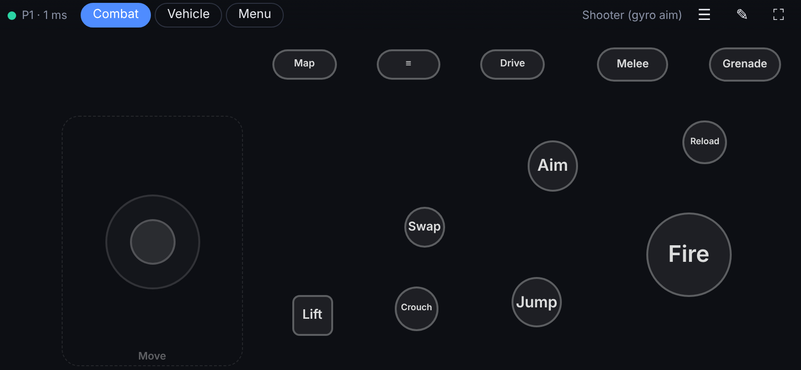

# PadForge

Turn your phone into a custom game controller for **Steam on Windows** and **Steam Deck / Linux**.

- **Build your own layouts.** Buttons, analog sticks, d-pads, analog triggers and touchpads, placed anywhere and sized however you like.
- **Swap screens instantly.** Each layout can have several pages, such as Combat, Vehicle and Menu. Swap with tabs, a "go to" button, or a "show while held" button that works like a shift key. Controls marked "every screen" keep working during a swap, so you can keep moving while you switch.
- **Motion controls.** Gyro aiming to the right stick or mouse, or steering with roll. Options include smoothing, dead band, "hold to aim" and ratcheting (lift to re-centre). DS4 mode can instead pass raw gyro data to Steam Input.
- **Feels like a real pad.** Floating sticks, dead zones and response curves, sliding between buttons, turbo, toggles, combos (e.g. `Ctrl+C`), haptics on press, and game rumble passed back to the phone.
- **Steam sees a real controller.** You get a virtual Xbox 360 pad (or DualShock 4 on Windows), so Steam Input, Big Picture and per-game Steam configs all work. Keyboard and mouse output covers games without controller support.
- **Multiplayer and auto-switching.** Up to 8 phones, each its own controller. Layouts can switch automatically when a matching game gets focus.
- **Sharing.** Export and import layouts as JSON.



## How it works

```
 phone (web app) ──Wi-Fi/LAN, WebSocket──▶ PadForge bridge (PC or Steam Deck)
                                             ├─ virtual Xbox 360 / DS4 pad ──▶ Steam / games
                                             └─ virtual keyboard + mouse
```

The bridge serves the phone app itself, so there's nothing to install on the phone. Scan the QR code the bridge prints and play. On iPhone, use **Share → Add to Home Screen** for full screen.

## Quick start

See **[docs/STEAM.md](docs/STEAM.md)** for step-by-step setup:

- **Windows:** install [ViGEmBus](https://github.com/nefarius/ViGEmBus/releases) and [Node.js](https://nodejs.org), then run `bridge/scripts/start-windows.bat`.
- **Steam Deck:** in Desktop Mode, run `bash bridge/scripts/install-steamdeck.sh`. It runs in the background, including in Game Mode.

Then open the printed link on your phone, accept the certificate warning once (needed for motion controls), and tap **Start**.

## Editing layouts

Tap **✎** to edit:

- Drag a control to move it, and drag its blue corner to resize.
- Tap a control to change what it does.
- **Screens** adds and arranges pages.
- **Motion** sets up the gyro.
- **Layout** handles naming, auto-switch program names, export/import and "save as new".

Layouts are saved on the PC in `~/.padforge/layouts/`.

## Project layout

| Path | What |
|---|---|
| `app/` | Phone app (plain ES modules, no build step) |
| `bridge/src/server.js` | WebSocket and HTTP server, players, pairing, safety release |
| `bridge/src/outputs/` | `vigem.js` (Windows pads), `winkbm.js` (Windows keyboard/mouse), `uinput.js` (Linux / Steam Deck) |
| `bridge/layouts/` | Built-in layouts, generated by `scripts/make-layouts.js` |
| `docs/PROTOCOL.md` | Phone ↔ bridge protocol |

## Tests

```bash
cd bridge
npm test             # bridge: protocol, pairing, multi-phone, stuck-input safety, layouts
node test/e2e.js     # drives the phone app in an emulated phone with real multi-touch (needs Playwright)
```

## Status and limits

- Tested here: the bridge, protocol and phone app, end-to-end in an emulated phone.
- **Not yet tested on real hardware:**
  - ViGEm and SendInput on Windows.
  - uinput on a Steam Deck.
  - Real phone gyros.
- iPhone browsers can't vibrate, so haptics are Android-only until there's a native app wrapper.
- Auto layout switching uses the focused window. It works on Windows and on Linux desktops with `xdotool`, but not in Steam Deck Game Mode.
- Planned:
  - Native app (Capacitor) for iOS haptics, Bluetooth and on-device voice commands.
  - Native DS4 gyro on Linux via uhid.
  - A plugin SDK so games can send minimaps and live info to the phone.
  - An ESP32 dongle for Switch 2.
